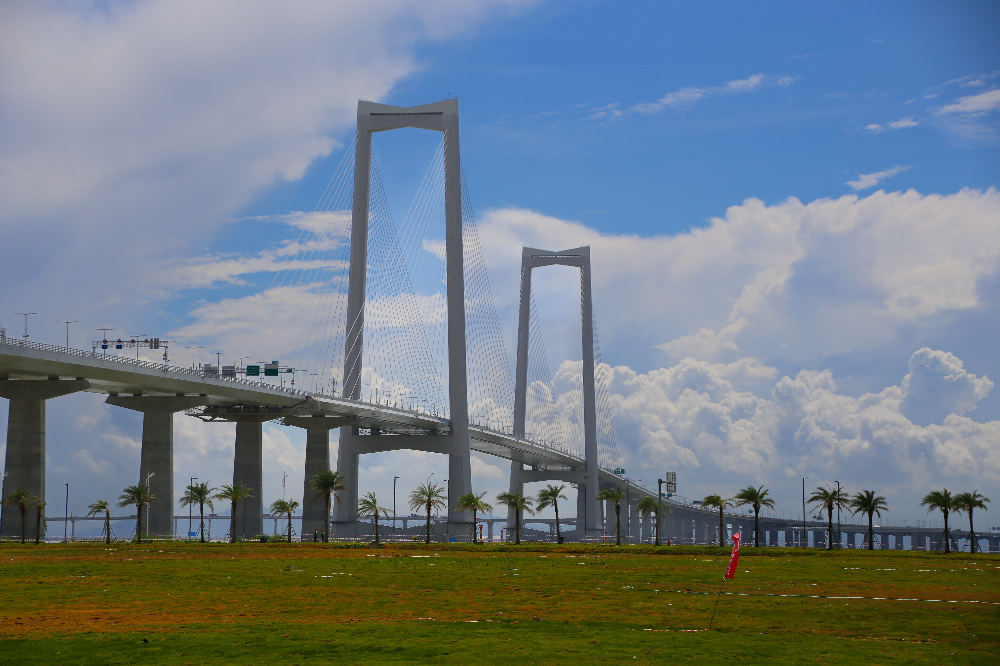
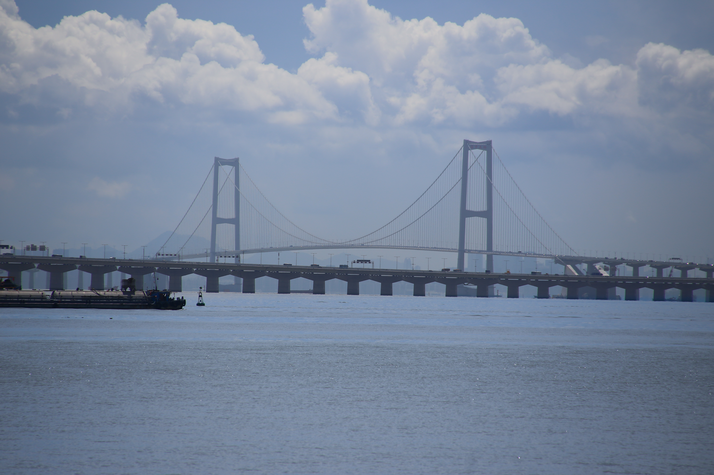
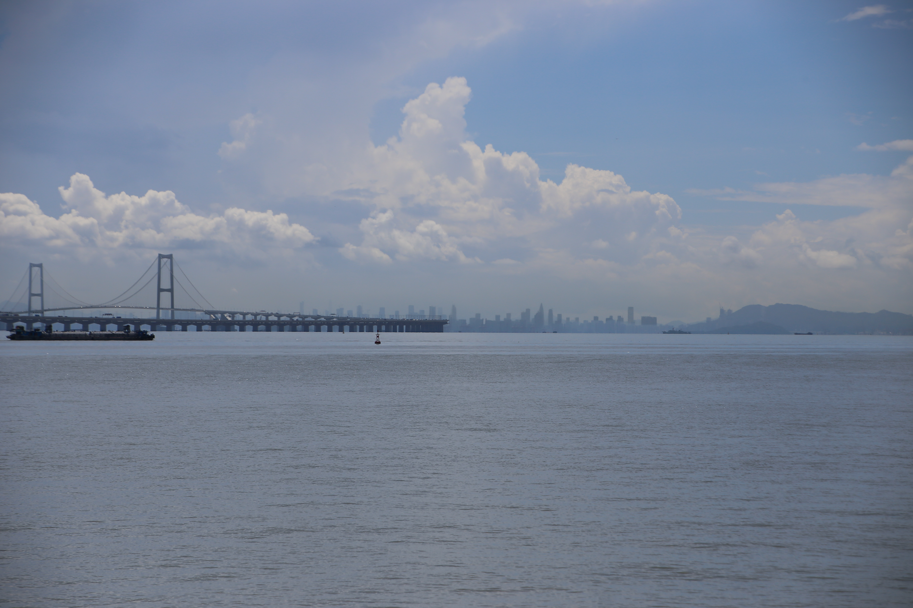
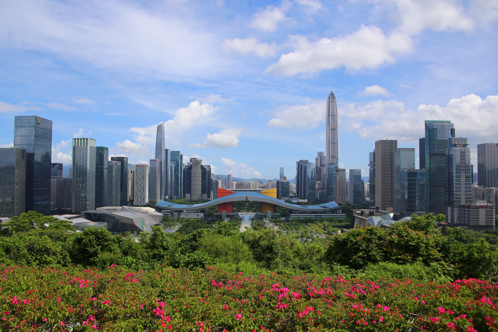
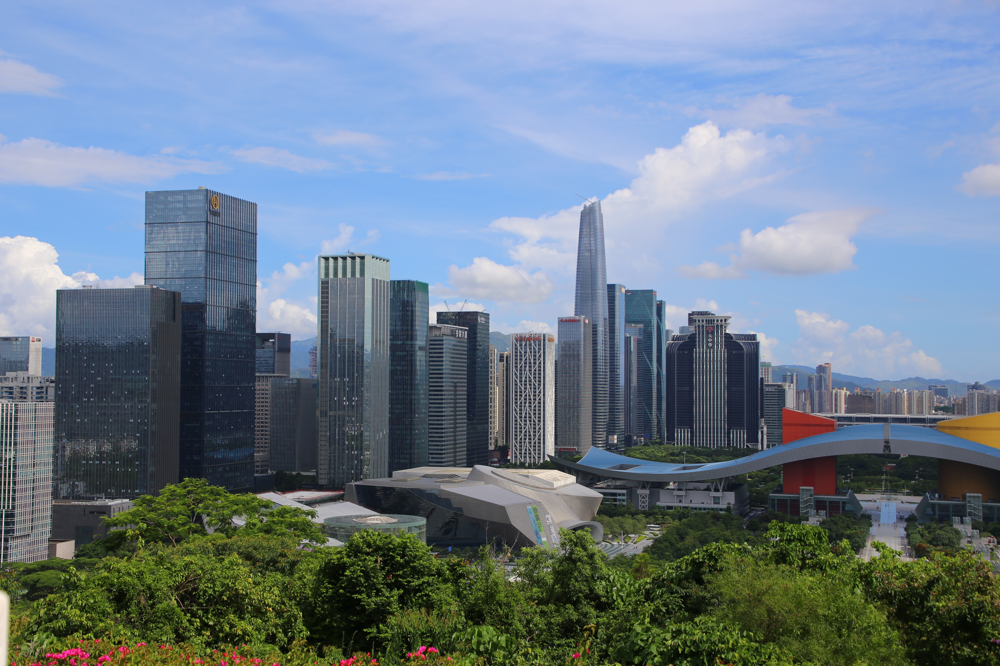
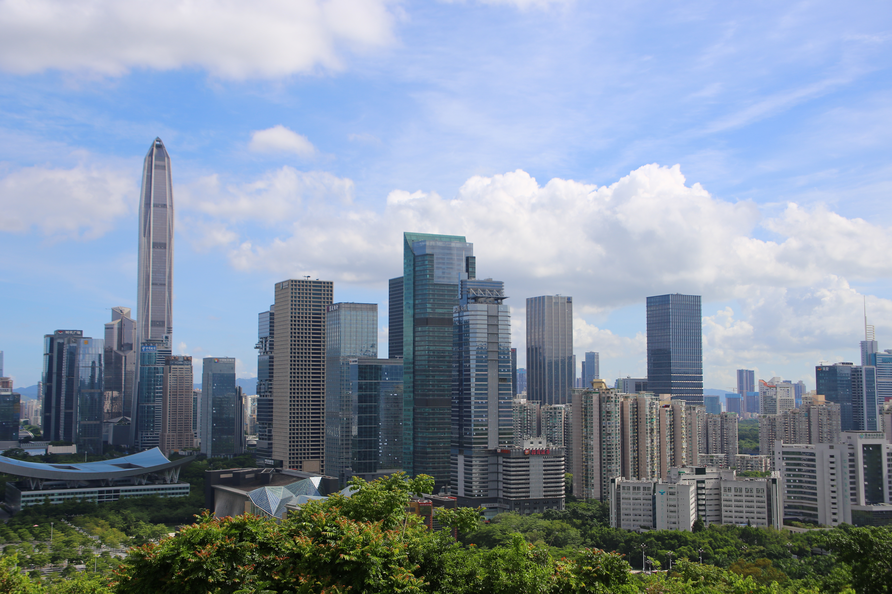
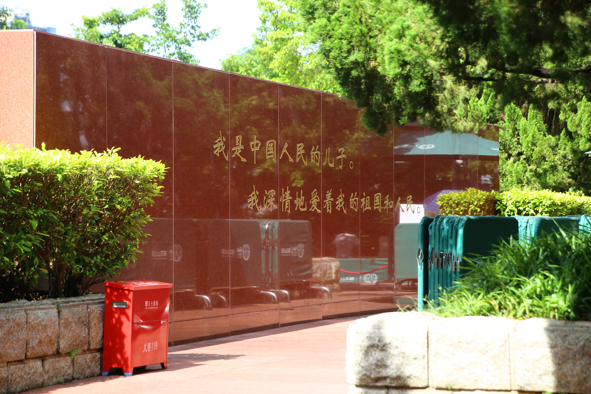
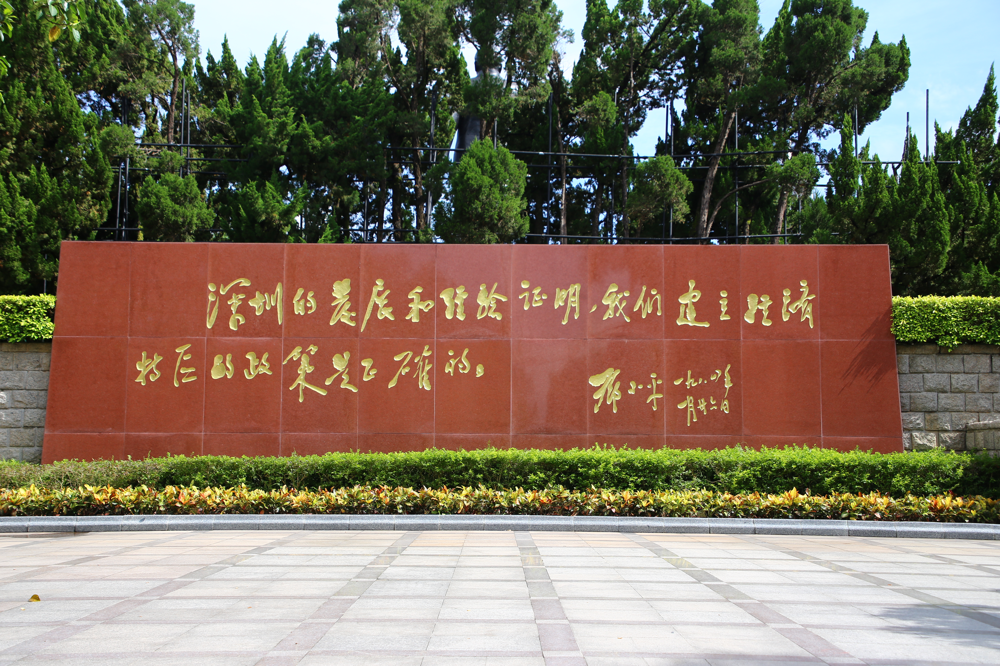
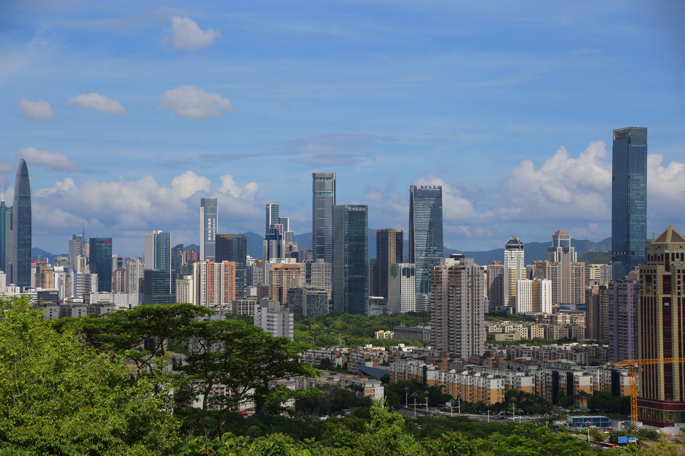
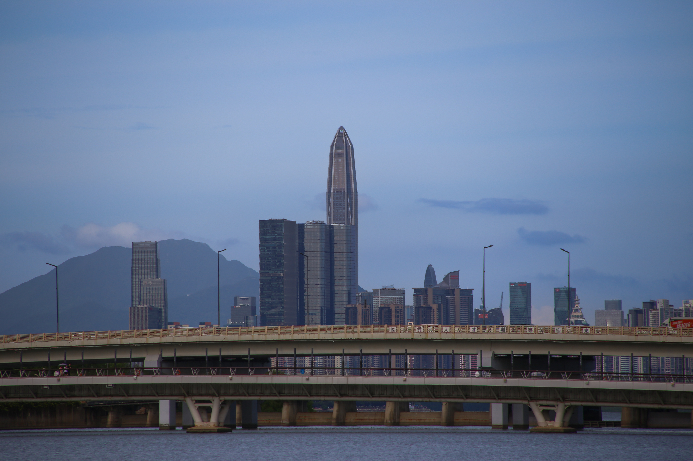

# 深圳

深中通道在2024年6月30日正式通车试运营，连接了珠江口两岸。开通没多久，我也去试了一下，顺便到深圳走走，看看这座改革开放以来最具代表性的城市之一。照片就按照这趟路上的顺序，从深中通道一直看到深圳的城市风景。

先来到深中通道旁。桥塔高高立在蓝天和白云之间，桥面从草地和一排棕榈树的上方伸向远处。

换到海边，隔着水面看桥。两座桥塔和弧形的缆索连在一起，桥下还有船只经过，更能看出这座桥的尺度。

视线再往远处拉，桥逐渐变小，海面一直延伸到天边。远处的城市轮廓淡淡地藏在云下。

来到深圳，先从高处望向城市。前面是盛开的花和茂密的树，后面是层层高楼，平安金融中心从天际线中间升起来。眼前的城市面貌，也让人想到深圳这几十年来的变化。

稍微换一个角度，楼群和市民中心的屋顶更加清楚。绿树铺在城市前面，蓝天和白云给高楼留出了不少空间。

继续望向另一边，高楼和住宅一层层铺开。阳光落在建筑上，城市的轮廓在云下显得格外清晰。

绿树掩映的小路边，一面红色墙上留着金色的题字。走过这里时，城市的视线从远处的高楼回到了眼前。

另一面红色题字墙前是开阔的广场，阳光照在地面上，墙后的树木把画面围起来。

再看一眼城市，远近不同的楼群从绿树后面升起来，远处还能看到山。深圳的高楼和山林在这里被收进了同一个画面。

最后一张隔着水面望向深圳。桥横在前景，平安金融中心和远山立在暮色里，给这组照片留下一个安静的结尾。

