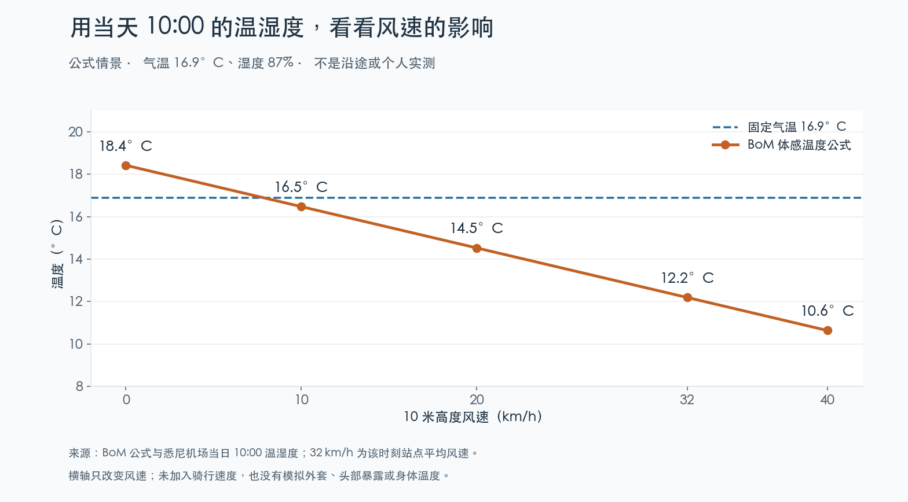
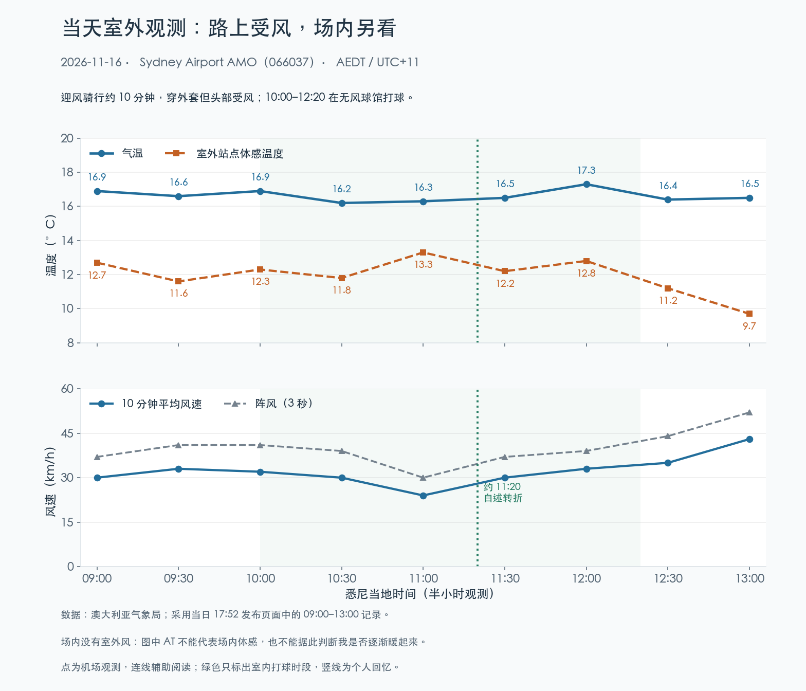
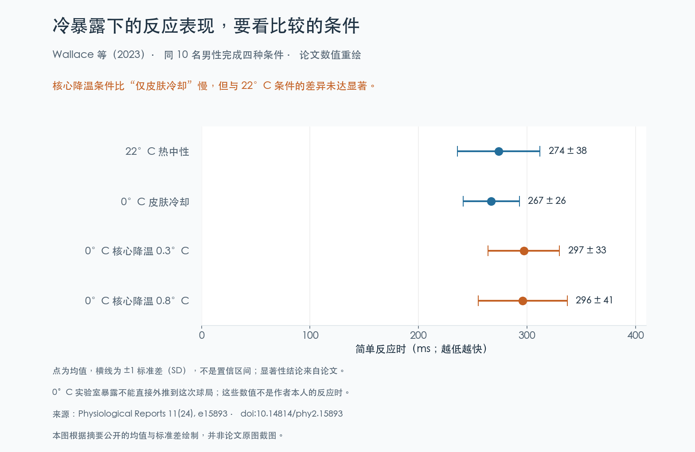
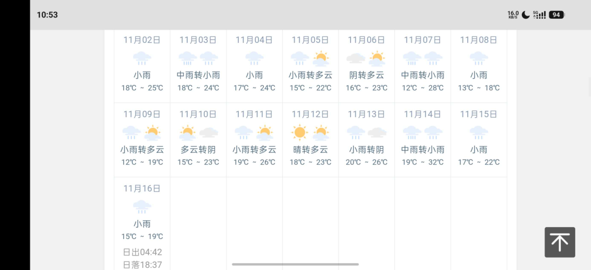

# 体感温度对运动的影响

今天早上跟球友约了个早上10-12的单打局，3个人打两个小时。因为大家的水平差不多，大概在±0.5级，所以无论和谁打我都不会面临体能不足的问题。但是吧看到标题，想必已经能知道我今天其实打的不是很好。先说结果：在10点到11点20分的时候，我的大脑几乎处在一个低频状态，有很多该反应过来的球我都没快速做出响应。在最后40分钟然后过了12点多打20分钟里，我回到了正常状态，开始能赢球。这个月虽然才过一半，但是早场的10-12单打局我打了不下4次，有两次（包括今天这次）是非常不在状态，还有两次是近乎全程满状态。这里有一个唯一取决于我的变量是前一晚的睡眠和当天的早餐，在这4场球里我控制了这个变量几乎不变。打前一晚我是会好好睡觉的，早上会吃点热食早餐然后泡茶或者咖啡喝。那么唯一的一个变量，也是我觉得最大的影响因素，就是天气。

### 当地天气问题

浅谈一下悉尼。其实我跟许多人讲我很喜欢悉尼的天气，但我是侧重于晴天的喜爱，而并非温度的喜爱。作为在广东长大的人，我以前的认知是广东在秋季入冬季的时候温差真的大的离谱，但直到大学在悉尼待了四年，我认为全世界应该没有地方的温差是能比的过悉尼了的。悉尼的温差可以大到让我早上起来感觉是冬季，中午是夏季，晚上又是冬季，而且这个不是只有换季才会发生的，而是全年性无休止一百多天都是这种温差。哪怕我在这待了四年，我仍然无法忍受这种温差，这其实是让我比较难受的。现在打羽毛球，我的主要交通方式是骑共享单车，虽然10分钟不到就能在家和球馆之间来回，但骑单车这种方式会添加另一个新的变量，就是风速。悉尼的风速也是出了名的大，有些瞬时风速让我想起了广东的台风，平常的平均风速也不会很低。所以在悉尼骑单车，对于我这种算是怕冷的人而言，穿防风外套是必须的。就算是入夏的时候，我也会备一件外套随身带着，以防悉尼的妖风把我吹寒。

### 研究方法

作为一个工科出身的人，发现问题然后解决问题是我比较享受去做的事情。针对这次打球遇到的问题，我就称作 **体感温度对运动性能的影响** 吧。这里为什么要专门说是体感温度，因为我觉得天气预报所汇报出来的温度完全不是我的体感温度，所以变量还是选择严谨点。体感温度的变化则是依赖实时温度和风速。运动性能我主要想提及的是反应问题，因为这次打球给我带来最直观的感受是，我的体能并没有被榨干，但是脑算力似乎只能在低频条件下运行，可以理解为CPU只用了小核中核，而该调度的大核缺由于温度问题始终调度不出来。后面一个小时我能回到正常状态打球，与实际温度提升有很大关系。

### 体感温度

先把今天的条件补完整。我去 NBC Alexandria 的路上，是迎着风骑了大概十分钟车。外套确实穿了，身上多少能挡住一些风，但脑袋挡不住，头脸还是直接迎着风的。到了球馆里面则没有风。所以我想分析的，是这十分钟的受风，会不会给后面的球局带来一个不太舒服的开局。

先算一下当时的体感温度。澳大利亚气象局 BoM 的[指标说明](https://www.bom.gov.au/info/thermal_stress/)给出了 Apparent Temperature，也就是 AT 的计算方法。前面我只提到了气温和风速，其实还需要湿度。无太阳辐射版本的公式是：

$$
AT = T + 0.33p_v - 0.70v - 4.00
$$

$$
p_v = \frac{RH}{100}\times6.105\times e^{\frac{17.27T}{237.7+T}}
$$

这里的 \(T\) 是气温，单位是 °C；\(RH\) 是相对湿度，单位是 %；\(v\) 是气象站 10 米高度的风速，单位是 m/s；\(p_v\) 是水汽压，单位是 hPa。BoM 原公式把水汽压写成 \(e\)，我这里换成 \(p_v\)，因为下面还要说到另一个 e，两个混在一起反而不好理解。

那就直接把当天 10:00 的数据代进去。我用的是 **2026 年 11 月 16 日 Sydney Airport AMO 气象站（066037）** 的[半小时观测](https://www.bom.gov.au/products/IDN60901/IDN60901.94767.shtml)，时间按悉尼当地夏令时 AEDT（UTC+11）。这个站的记录是：气温 **16.9°C**、相对湿度 **87%**、平均风速 **32 km/h**，阵风 **41 km/h**。先借用靠近到场时间的站点数据，估算附近露天环境；阵风不能当成整段路的持续风速，所以用 32 来算。

将所有该换算的单位换算一下：

$$
v=\frac{32}{3.6}\approx8.89\ \mathrm{m/s}
$$

指数里的数大约是 1.1464，做完 exp 运算大约是 3.1467：

$$
\begin{aligned}
p_v &= \frac{87}{100}\times6.105\times\exp\left(\frac{17.27\times16.9}{237.7+16.9}\right) \\
    &\approx0.87\times6.105\times3.1467 \\
    &\approx16.71\ \mathrm{hPa}
\end{aligned}
$$

最后把气温、水汽压和风速放回第一条公式：

$$
\begin{aligned}
AT &\approx16.9+0.33\times16.71 \\
   &\quad-0.70\times8.89-4.00 \\
   &\approx12.2\,{}^\circ\mathrm{C}
\end{aligned}
$$

算出来约 **12.2°C**，比气温显示的 16.9°C 低了约 4.7°C。BoM 页面公布的 AT 是 12.3°C，和用公开近似公式、页面显示数值重算的结果略有差异，后面的天气图仍保留原站数值。先不纠结这 0.1°C，至少可以看出来，当时在露天吹风的冷热感，不能只拿“接近17度”来理解。

### 路上的十分钟

不过，这个 12.2°C 还不能直接叫“我骑车时精确的体感温度”。我骑车的速度大约是 **25 km/h**，这个是大致速度，不是整段路的测速记录。今天又是迎风，所以脑袋迎到的气流，还得把自己往前骑的这一部分算进去。

先看完全正迎风的情况。空气朝我过来，我朝空气过去，两个速度的大小可以相加：

$$
v_{\mathrm{rel}}=v_{\mathrm{local}}+v_{\mathrm{bike}}
$$

这里的 \(v_{\mathrm{local}}\) 是路上当地的迎面风速，\(v_{\mathrm{bike}}\) 是相对地面的车速，\(v_{\mathrm{rel}}\) 才是我迎到的相对气流速度。如果暂时假设路上的迎面风也有站点记录的 32 km/h，就会得到：

$$
\begin{aligned}
v_{\mathrm{rel}}&\approx32+25=57\ \mathrm{km/h} \\
&=\frac{57}{3.6}\approx15.8\ \mathrm{m/s}
\end{aligned}
$$

这样一算，就能理解为什么站着觉得还能接受，骑起来却觉得风一直往脑袋上灌。在这个假设里，迎到的气流比站在同一处不动时快了约 78%。不过，57 km/h 是“当地风速等于站点风速、完全正迎风、当时车速25”这几个条件同时成立时的结果，不是沿途实测，也不是上限。街道有遮挡，风向会偏，等红灯还会停下来，不能说这十分钟里一直都在吹这么大的风。

就算暂时没有自然风，单是以 25 km/h 往前骑，也会迎到约 6.9 m/s 的相对气流。所以车速补进来以后，我更能理解“路程只有十分钟”为什么不等于“受风可以忽略”。但这里还不能直接把 57 填回前面的 AT 公式。[BoM 的说明](https://www.bom.gov.au/info/thermal_stress/)里，这套指标以阴影中步行的成人为模型，风速输入是 10 米高度的环境风；骑车时头脸迎到的相对气流，是另一个量。直接替换，并没有同时处理骑车的产热、衣服和各部位受风的差别。前面的 12.2°C 仍然用来交代室外天气，25 km/h 则补充说明我在这个天气里是怎么受风的。

外套这个条件也得算进理解里。我的身体并不是所有部位都同样暴露：身上有衣服挡着，头脸却还在迎风。因此，我更关心的不是“全身有没有被冻透”，而是身体有保护的情况下，暴露在风里的头脸，能不能已经冷得让我不舒服。外套穿了和脑袋被风吹得冷，这两件事完全可以同时成立。

这个区别也有比较贴近骑车场景的实验可以参考。[Mukunthan 等人 2019 年的研究](https://www.mdpi.com/2076-3417/9/18/3672)把加热的头部模型放进风洞，在约 20.5°C 的空气中，用 3 m/s 和 6 m/s 两档来风做测试。不戴头盔的模型条件下，对流热流密度从约 192 增加到 216 W/m²，也就是每平方米每秒散掉的热量增加了约 12.5%。这不是拿真人测脑温，而是在固定模型温度下，看维持温度需要补回多少热。它支持的是：头部周围的空气流动加快，确实可以加强散热。实验最高只测到 6 m/s，不能拿这个增幅继续外推到前面假设的 15.8 m/s，更不能换算成我的脑袋降了几度。

所以对我来说，骑车有两件事在同时发生：腿在蹬，身体会产热；人往前走，头脸也在持续迎风。身上有外套，觉得身体不冷，并不能替头脸做判断。反过来，风速增加了约 78%，也不代表散热就增加 78%，更不是反应会慢 78%。这次能往前推进的一步，是把“我为什么会觉得头冷”说得更具体了；后面的注意力有没有被影响，还得接着看。

当天完整的室外记录放在下面，方便对照。9:30 的站点 AT 是 11.6°C，10:00 是 12.3°C，能交代出门前后的天气背景，但不能还原我路上每一分钟的风。绿色区域只标出我打球的时段，里面那条室外 AT 曲线，不能继续当成我进馆后的体感。

### 这样的体感会怎么影响我

算到这里，我想问的就具体了一点：附近露天环境的体感指标大约是 12°C，我又是迎风骑车、头脸没有挡住，这样会怎么影响后面的状态？我觉得得先从最直接的一步看，就是暴露部位的散热和冷感，而不是直接跳到“大脑被冻慢了”。

加上约 25 km/h 的车速以后，迎风增加头脸散热这一步更值得考虑了。不过它补充的是路上的暴露条件，并没有直接证明我到场以后反应变慢的原因。车骑得快，既会增加来风，也可能增加运动产热，最后落到我身上的冷感和状态，还得看两边合起来是什么结果。

[Briggs 等人 2017 年的一项研究](https://pubmed.ncbi.nlm.nih.gov/28497171/)刚好研究了类似的暴露方式：冬季衣服能保护身体大部分区域，但面部仍露在风中。研究者用热成像观察面部降温，发现最初几分钟就会发生冷却，而且不同部位速度不一样，鼻子和脸颊降得更快。这支持了我在意的那个点：穿了外套，不代表暴露的头脸就不会受到风的影响。不过研究是在冬季条件下做的，测的是面部皮肤，不是我的头部或脑温，不能据此算出我今天具体降了几度。

那么，脸上觉得冷，为什么可能连到接球反应？一个解释是，冷感本身会分散注意力。[Mäkinen 等人 2006 年的实验](https://pubmed.ncbi.nlm.nih.gov/16309719/)让 10 名男性在连续 10 天里接受 10°C 与 25°C 条件的测试，结果并不是所有任务都变差，而是有变差、变好和混合变化。作者把分心，以及唤醒程度的改变，作为解释这些表现的机制。也就是说，冷刺激不一定让所有人都迟钝，有时也可能让人更清醒，要看当时的任务和身体反应。

放回我这里，可以提出一个比较具体的推测：如果头脸受风后的冷感和不适在到场时还很明显，它可能占着一部分注意力，让我没有那么容易把精神集中到对手动作、落点判断和第一步启动上。羽毛球这套过程衔接得很快，只要其中一环跟不上，最后表现出来就是“这球明明应该反应过来，我却没动”。这条路径能解释我为什么觉得体能还有、反应却不对劲，但目前仍然是对这次球局的推测，没有测到我实际分散了多少注意力。

更广一点的证据也有。[Falla 等人 2021 年的系统综述](https://pubmed.ncbi.nlm.nih.gov/34574649/)整理了 18 项研究，其中 8 项是冷空气暴露、10 项是冷水浸泡，15 项发现了某些认知表现下降。不过，这个数字只能说明冷暴露影响认知是值得研究的方向，不能变成我今天受影响的概率。尤其是我算出来的 12.2°C 是体感指标，不能直接等同于实验室里实际 10°C 的空气，更不能把不同暴露时间、衣服和活动状态都省掉。

还有一个得放在一起看的结果。[Wallace 等人 2023 年的实验](https://pubmed.ncbi.nlm.nih.gov/38114071/)让同 10 名男性分别经历四种条件：22°C 环境、0°C 下仅皮肤明显冷却，以及 0°C 下核心体温较基线下降 0.3°C 或 0.8°C。简单反应时的均值分别是 274、267、297 和 296 毫秒。

这里核心降温条件比仅皮肤冷却条件更慢，但与 22°C 条件相比，差异没有达到统计显著，工作记忆和执行功能的反应时也没有显著变差。它提醒我，觉得冷和客观反应变慢不能直接画等号，更不能因为脑袋被风吹，就认定脑温下降了。

所以结合当天的计算和这些研究，我目前的判断是：迎风、头脸暴露，可能通过局部冷却和冷感不适，影响我到场时的注意力与进入比赛的状态。这是比“体感12度，所以大脑必然降频”更有依据的一种解释。12.2°C 本身不是一个反应变慢的门槛；这十分钟的受风，能不能解释后面一个多小时的低状态，现有证据还接不上，不能把中间这一段直接省略。

### 进馆以后

到了球馆，室外的风就不再持续吹着我了。为了看清这一点，可以沿用 10:00 的气温和湿度，只把环境风速设为零：

$$
\begin{aligned}
AT_{v=0} &\approx16.9+0.33\times16.71-4.00 \\
         &\approx18.4\,{}^\circ\mathrm{C}
\end{aligned}
$$

相同温湿度下，仅去掉风这一项，指标就相差约 6.2°C：

$$
\Delta AT=0.70\times\frac{32}{3.6}\approx6.2\,{}^\circ\mathrm{C}
$$

这个 18.4°C 是无风情景，不是实测的球馆温度，也不是说一进门身体就瞬间暖了 6.2°C。场内温湿度没有测，跑动本身也会带来相对气流。但它把前后两个环境的区别说清楚了：路上的风已经停在球馆外面，不能再拿机场风速来给我的场内体感扣分。

现在车速也有了一个大致数值，这个变化就更好理解：进馆以后，不只是室外迎风没了，骑车时约 25 km/h 的持续前进也结束了。打球跑动仍会带来气流，但已经不能沿用路上的 57 km/h 假设。受风条件可以很快改变，冷感和进入比赛的状态却未必跟着立刻切换；至于需要多久，我这次没有测到，不能用车速倒推出一个多小时的恢复时间。

再看后面的温度。室外气温在 10:00 到 10:30 先从 16.9°C 降到 16.2°C，随后几个点是 11:00 的 16.3°C、11:30 的 16.5°C，以及 12:00 的 17.3°C。后面这一段逐步回升。如果分别沿用这些时刻的气温和湿度，都把风速设为零，算出的 AT 依次约为 17.5、17.8、17.9 和 19.0°C。这些依然是室外数据对应的无风情景，不能冒充球馆实测，但也说明，外面的 AT 被风压着，并不代表没有风的地方也一样冷。

我的实际感受就是，球馆里没有风，温度也在慢慢、比较稳定地往上走。到 11:20 左右，我已经在里面运动了一个多小时。三个人中间有轮换，但也早已不是刚骑车到场、刚拿起拍子的状态。没风、感觉环境逐渐变暖、已经运动了一段时间，这三个条件是叠在一起的。

身体逐渐暖起来这件事，也有运动表现方面的研究可以参考。[Faulkner 等人 2013 年的实验](https://pubmed.ncbi.nlm.nih.gov/22935735/)让 11 名男性自行车运动者先热身 15 分钟，休息 30 分钟，再做 30 秒最大冲刺。休息时使用电加热裤的条件，比穿普通运动裤的条件保留了更高的肌肉温度，随后峰值功率高了 9.6%。它说明，体能有没有剩余和当时能不能把爆发力发挥出来，不完全是一回事。但这不是头部受风实验，冲刺功率也不是接球反应时，所以它只能帮助理解热身和维持肌肉温度的作用，不能拿 9.6% 来当我的提升幅度。

这样看，前面可能是受风后的冷感和进入状态的问题，后面则有无风环境、感觉逐渐暖起来和运动本身的共同影响。它们可以连成一个合理的解释，但我还没有测到中间每一步。对手疲劳、我越来越熟悉线路等因素，也可能一起起作用。

### 再看看这四次球

前面说这个月打了四次类似的早场，具体是 11 月 8、11、12 和今天的 16 号。其中，8 号和 16 号是我打得最不舒服的两次，11 号和 12 号则基本是满状态。把我自己截的天气历史翻出来，跟这四次的感受放到一起，区别还挺直观的。

- **11 月 8 日：13–18°C，小雨。** 这次是状态最差的两次之一。
- **11 月 11 日：19–26°C，小雨转多云。** 这次基本全程满状态。
- **11 月 12 日：18–23°C，晴转多云。** 这次也基本全程满状态。
- **11 月 16 日：15–19°C，小雨。** 就是今天，前面一个多小时不在状态，后面才慢慢回来。

最让我在意的是，状态好的 11、12 号，图里温度范围的下限已经有 19°C 和 18°C，差不多到了状态差的 8、16 号的上限。也就是说，至少从这张图给出的天气背景看，这两组日子的冷热差别是比较明显的。不是我今天打不好，才随手找个“天气冷”的理由；回头看另外三场，较冷的两天，恰好也是我最不舒服的两天。

作为自己的生活观察，这个对照已经让我更想继续查温度这个因素了。睡眠和早餐我尽量保持一致，至少少了一些明显差别；只是四场球还不算控制实验，前几天的运动量、对手和当天的心态也不可能完全一样。所以我现在更愿意说：这四次经历和“较冷的时候，我更难进入状态”是吻合的。

### 结论

写到这里，我会把今天的经历理解成：迎风骑车时头脸暴露；附近露天环境约12°C的体感指标，加上这十分钟的受风，让冷感干扰状态成为一个值得怀疑的因素。进馆后没有风，感觉环境在变暖，再加上已经运动一个多小时，后面才逐渐回到舒服、能正常输出的状态。

在前一个小时的对抗中，当我每次打出伪人球的时候（如正常高远球出边线，网前挑球出底线），我就在想我的cpu大核怎么一直动不起来呢？我的能效曲线在前一个小时里可以说是高功率对应低分数的一个状态了，但是想这些都不如人直接暖起来更实在。

下次最直接的改变，应该是要在打球之前先对天气和气温有个全方位的了解，然后选择最佳的时刻去打。因为说实话，当自身状态很差昏招频出的时候，其实对手也不会有很好的体验感。下次可以增加一个探讨的题目就是为什么我的两个对手好像没被温度克制，他们似乎是正常状态。虽然只是打了两个小时球，但因为这场球也算是没少学点新东西。本质上还是为了下次能打的更好，状态最佳。那今天这个饭后杂谈就写到这了，后面有一些参考来源，因为涉及到一些计算和查资料，所以这一章饭后杂谈用到了一点点AI帮忙，望理解！！

### 数据与参考资料

- 澳大利亚气象局：[Sydney Airport — Latest Weather Observations](https://www.bom.gov.au/products/IDN60901/IDN60901.94767.shtml)。当天区域天气来源，访问于 2026-11-16。
- 澳大利亚气象局：[Thermal Comfort observations](https://www.bom.gov.au/info/thermal_stress/)。AT 的定义、公式与适用限制。
- Falla M 等，2021：[The Effect of Cold Exposure on Cognitive Performance in Healthy Adults: A Systematic Review](https://pubmed.ncbi.nlm.nih.gov/34574649/)。International Journal of Environmental Research and Public Health，18(18): 9725。DOI：10.3390/ijerph18189725。
- Wallace PJ 等，2023：[Effects of skin and mild core cooling on cognitive function in cold air in men](https://pubmed.ncbi.nlm.nih.gov/38114071/)。Physiological Reports，11(24): e15893。DOI：10.14814/phy2.15893。图3根据公开均值与标准差自行绘制。
- Faulkner SH 等，2013：[Reducing muscle temperature drop after warm-up improves sprint cycling performance](https://pubmed.ncbi.nlm.nih.gov/22935735/)。Medicine & Science in Sports & Exercise，45(2): 359–365。DOI：10.1249/MSS.0b013e31826fba7f。
- Briggs AGS、Gillespie TJ、Brown RD，2017：[Measuring facial cooling in outdoor windy winter conditions: an exploratory study](https://pubmed.ncbi.nlm.nih.gov/28497171/)。International Journal of Biometeorology，61(10): 1831–1835。DOI：10.1007/s00484-017-1368-3。
- Mäkinen TM 等，2006：[Effect of repeated exposures to cold on cognitive performance in humans](https://pubmed.ncbi.nlm.nih.gov/16309719/)。Physiology & Behavior，87(1): 166–176。DOI：10.1016/j.physbeh.2005.09.015。
- Mukunthan S 等，2019：[Thermal-Performance Evaluation of Bicycle Helmets for Convective and Evaporative Heat Loss at Low and Moderate Cycling Speeds](https://www.mdpi.com/2076-3417/9/18/3672)。Applied Sciences，9(18): 3672。DOI：10.3390/app9183672。头部模型风洞实验，不是真人认知或脑温实验。
